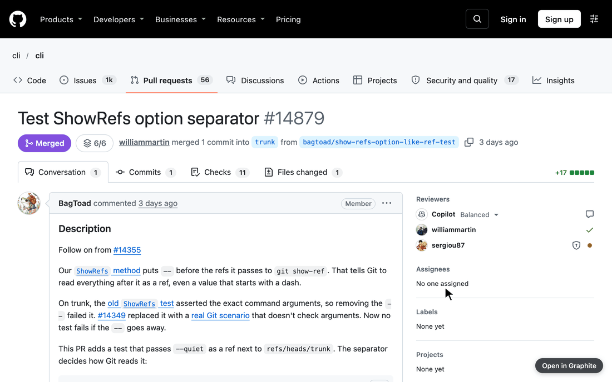

# github-graphite-switcher

A small Chrome extension that switches a pull request between GitHub and Graphite.

*Logged out here, so Graphite shows its login page.*

- On a PR page, a button in the bottom-right corner says "Open in Graphite" or "Open in GitHub". Cmd-click opens it in a new tab.
- Clicking the extension's toolbar icon, or pressing Option+Shift+G, does the same thing.

## Install

1. Go to `chrome://extensions` and turn on **Developer mode**.
2. Click **Load unpacked** and pick this folder.

The shortcut can be changed at `chrome://extensions/shortcuts`.
